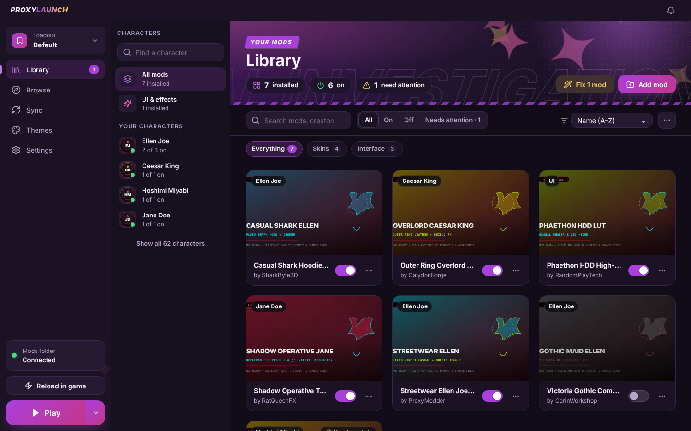
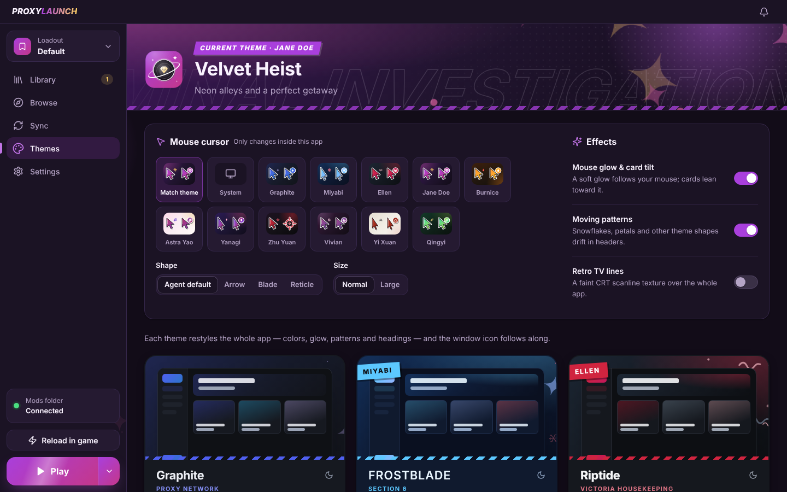

<p align="center">
  
</p>

<h1 align="center">ProxyLaunch</h1>

<p align="center">
  A clean, all-in-one desktop mod launcher for Zenless Zone Zero.<br>
  Install, organize and switch skins without juggling folders by hand.
</p>

<p align="center">
  <a href="https://github.com/saiochiro/zzz-mod-manager/releases/latest"><b>⬇ Download the latest version</b></a>
</p>

<p align="center">
  
</p>

## Features

- **One-click installs from GameBanana.** Browse mods inside the app and install them instantly. No manual extracting or dragging files into folders.
- **Works with XXMI.** ProxyLaunch syncs your mods into XXMI, so they load in-game the same way they always have.
- **Mod updates.** When a creator updates a mod on GameBanana, you get an Update button. Your old version is kept as a backup.
- **App updates.** The app tells you when a new version is out and updates itself in two clicks.
- **Outfit switching.** Turn outfits on and off per character, and cycle them in-game with H.
- **Fix after game patches.** Finds mods that broke after an update and repairs them in one click.
- **Import from other launchers.** Bring your existing mod setup over in a few clicks.
- **Mod Workshop (experimental).** Mix parts from mods you have, like the hair from one mod and the jacket from another, into your own mod. Post it on the in-app Community page or share it with a code. Either way the original creators keep their credit and downloads.
- **Agent themes and cursors.** 16 themes inspired by ZZZ agents, each with its own colors, background, animated effects, app icon and mouse cursor.

<p align="center">
  
</p>

## Requirements

- Windows 10 or 11
- [XXMI Launcher](https://github.com/SpectrumQT/XXMI-Launcher) with ZZMI installed. Open XXMI once and set up Zenless Zone Zero before using ProxyLaunch.

## Install

1. Go to the [latest release](https://github.com/saiochiro/zzz-mod-manager/releases/latest).
2. Download **`ProxyLaunch-Setup-x.x.x.exe`**. The other files on the release page are used by the app's auto-updater, so you can ignore them.
3. Run it and follow the installer.

Windows may show **"Windows protected your PC"** because the app isn't code-signed. Click **More info**, then **Run anyway**. The full source code is in this repository.

Prefer no install? Download **`ProxyLaunch-Portable-x.x.x.exe`** instead. It runs straight from the file but does not auto-update.

## Updating

Installed copies check for updates when they start. When a new version is out you'll see a popup with what's new. Click **Update now**, then **Restart & update**. Your mods, settings and themes are kept.

## Building from source

You need [Node.js](https://nodejs.org) 20 or newer.

```bash
npm install
npm run dev        # run the app in development mode
npm run build      # compile the app
npx electron-builder --win nsis portable   # build the installer into release/
```

On Windows you can also just double-click `Launch_ZZZ_Mod_Manager.bat` to run it, or `Build_Installer.bat` to build the installer.

### Publishing a release

Releases are built automatically by GitHub Actions (`.github/workflows/release.yml`).

**Easiest:** double-click `Publish_Update.bat`. It asks for the new version number and what changed, then sends everything to GitHub.

**By hand:**

1. Raise `"version"` in `package.json`.
2. Describe the changes in `RELEASE_NOTES.md`. This text is shown in the in-app update popup.
3. Push to `main`.

Either way, GitHub builds the installer on Windows and publishes release `vX.Y.Z` with the installer, its `.blockmap` and `latest.yml`. Installed apps then show the update popup.

## Contact

Questions, bug reports or suggestions? Reach out on Discord: **ghxty**, or [open an issue](https://github.com/saiochiro/zzz-mod-manager/issues).

<sub>ProxyLaunch is a fan-made tool and is not affiliated with or endorsed by HoYoverse.</sub>
